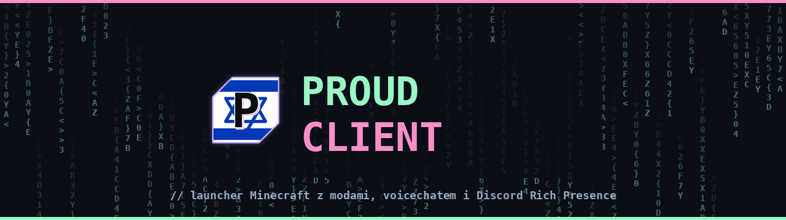
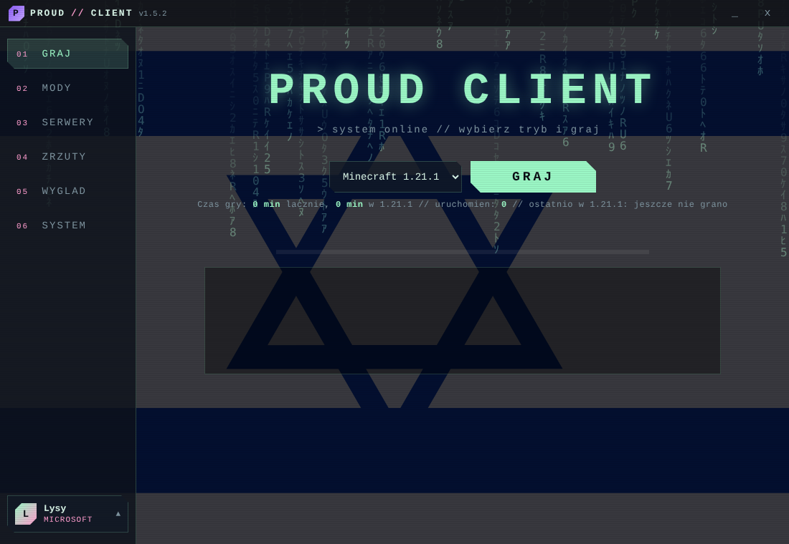
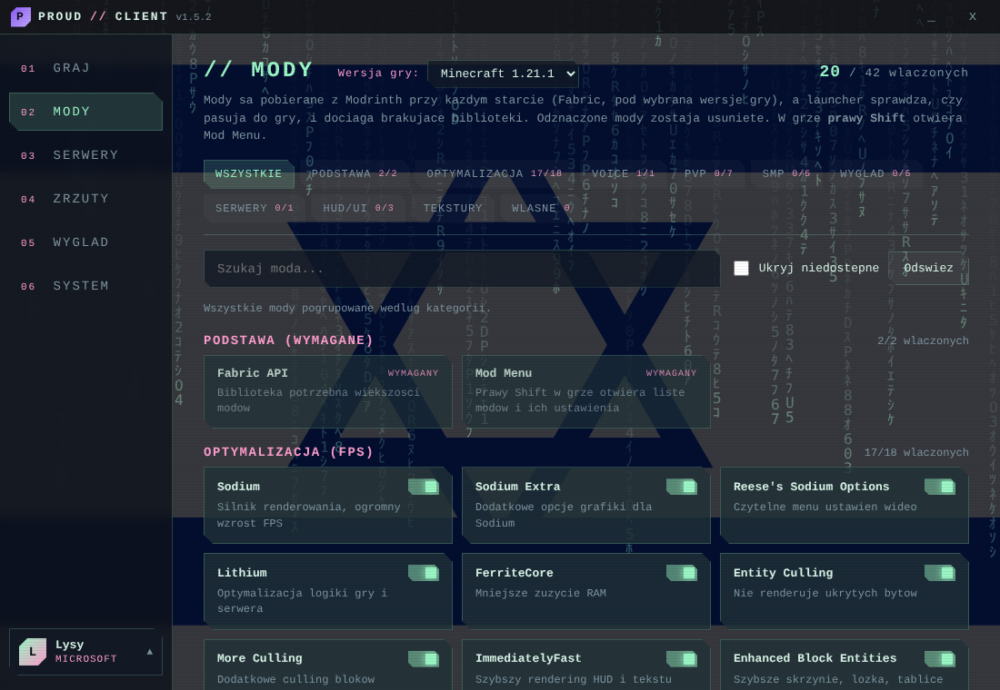
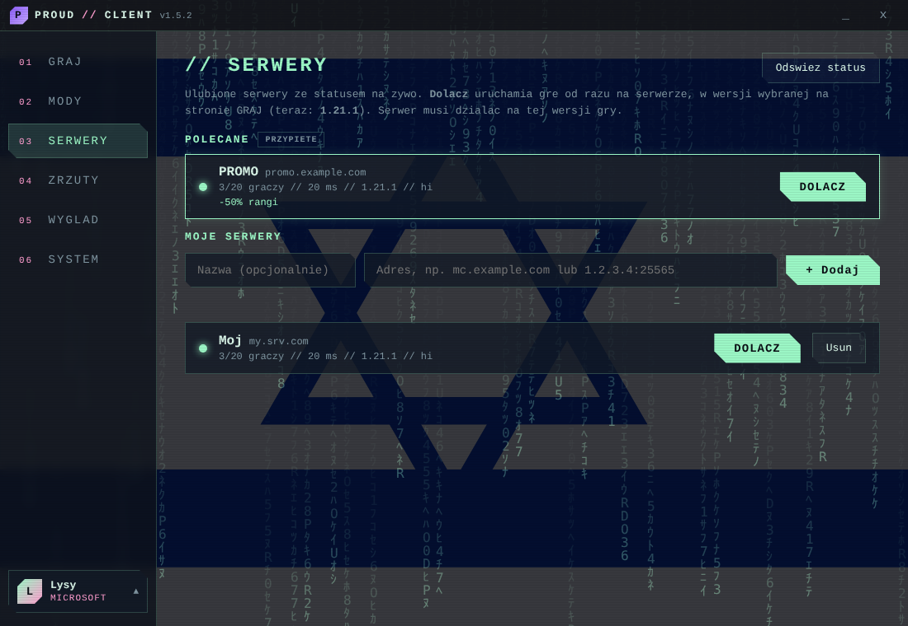

### Launcher Minecraft z gotowymi modami, voicechatem i własnym wyglądem gry

---

## Co to jest

**Proud Client** instaluje Fabric i dobrane mody sam, osobno dla każdej wersji Minecrafta. Wybierasz wersję, klikasz **GRAJ** i gotowe: mody optymalizujące FPS, voicechat, mody pod PvP i SMP oraz własny wygląd menu gry.

## Funkcje

- **Mody z Modrinth, instalowane automatycznie.** Launcher sprawdza, które mody mają wersję pod wybraną wersję gry, dociąga biblioteki i weryfikuje sumy kontrolne.
- **Osobny profil dla każdej wersji.** Własne mody, ustawienia, światy i zrzuty ekranu dla każdej wersji osobno.
- **Optymalizacja FPS.** Sodium, Lithium, FerriteCore i inne, z presetami dla słabego PC, zbalansowanym i jakościowym.
- **PvP i SMP.** Mod Menu pod prawym Shiftem, FPS overlay, Fullbright, HUD i inne.
- **Voice chat.** Simple Voice Chat gotowy do gry.
- **ViaFabricPlus.** Wejście na serwery działające na innej wersji gry.
- **Własny wygląd gry.** Paczki tekstur Visuals (logo, *Solo* i *Party*), Proud PVP oraz Proud Gear (miecze i zbroje), a także własne tło menu.
- **Wiele kont.** Konta Microsoft i offline, szybkie przełączanie.
- **Serwery.** Lista ulubionych ze statusem na żywo, polecane serwery i dołączanie jednym kliknięciem.
- **Discord Rich Presence.** Na Discordzie widać „Proud Client”, wersję gry i serwer.
- **Zrzuty ekranu, statystyki czasu gry, eksport i import profilu.**
- **Chowa się do zasobnika.** Gra działa dalej po zamknięciu launchera.
- **Automatyczne aktualizacje.**

  
  

## Instalacja

1. Wejdź w [**Releases**](https://github.com/exifez/PROUD-CLIENT/releases/latest) i pobierz `Proud-Client-Setup-<wersja>.exe`.
2. Uruchom instalator i wybierz folder.
3. Zaloguj się kontem Microsoft (albo dodaj konto offline) i kliknij **GRAJ**.

Wymagana jest Java: **Java 21** dla Minecrafta 1.21.x, **Java 17** dla 1.18–1.20.4.

> **Windows SmartScreen może pokazać ostrzeżenie „Nieznany wydawca”.** Instalator nie jest jeszcze podpisany certyfikatem. Kliknij **Więcej informacji**, a potem **Uruchom mimo to**.

## Najczęstsze pytania

**Czy to bezpieczne?** Launcher pobiera mody wyłącznie z Modrinth i sprawdza ich sumy kontrolne. Konto Microsoft logujesz przez standardowe okno Microsoftu, a hasła nie widzi ani launcher, ani ja.

**Czy mogę dodać własne mody?** Tak, w zakładce MODY > WŁASNE, osobno dla każdej wersji gry.

**Jak się aktualizuje?** Launcher sam sprawdza nowe wersje i pyta o restart w SYSTEM > Aktualizacje.

**Gdzie są moje światy i ustawienia?** W folderze `.proudclient` w `%APPDATA%`. Odinstalowanie launchera ich nie usuwa.

**Coś nie działa.** Otwórz zakładkę [Issues](https://github.com/exifez/PROUD-CLIENT/issues) i opisz problem. Dołącz wersję gry i najlepiej log albo raport crasha.

## Prawa autorskie

© Proud Client. Wszelkie prawa zastrzeżone. Minecraft jest znakiem towarowym Mojang AB. Proud Client nie jest powiązany z Mojang ani Microsoft.
