

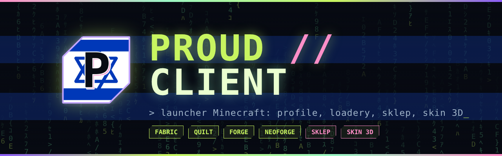

### Launcher Minecraft: profile, Fabric / Quilt / Forge / NeoForge, sklep shaderów i skin 3D

[**Pobierz**](https://github.com/exifez/PROUD-CLIENT/releases/latest) · [Funkcje](#funkcje) · [Instalacja](#instalacja) · [Loadery](#loadery-modów) · [FAQ](#najczęstsze-pytania) · [Historia zmian](CHANGELOG.md) · [Zgłoś problem](https://github.com/exifez/PROUD-CLIENT/issues/new/choose)

---

## Co to jest

**Proud Client** to launcher Minecrafta, który sam instaluje loader, dobrane mody i dodatki. Wybierasz profil, klikasz **GRAJ** i gotowe: więcej FPS, voicechat, mody pod PvP i SMP, shadery, własny wygląd menu gry i skin zmieniany prosto z launchera.

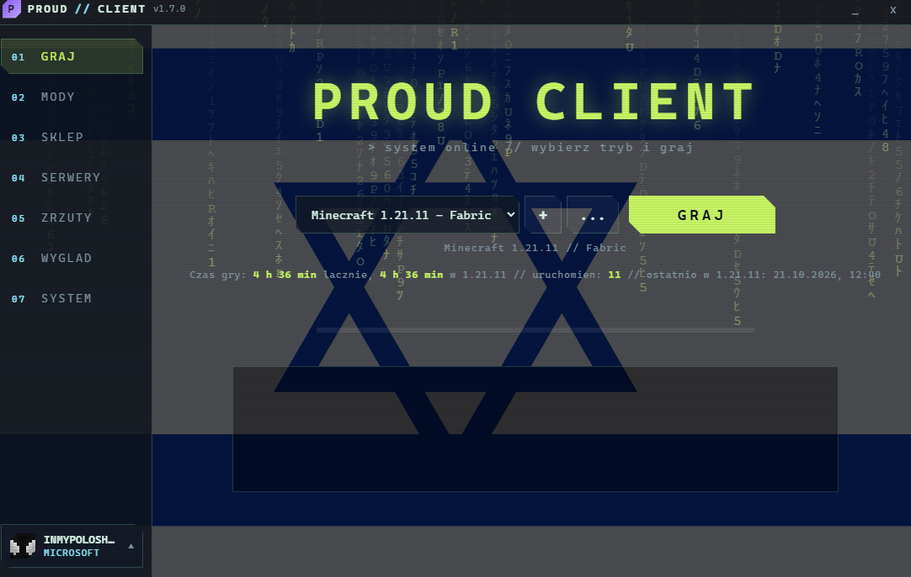

## Funkcje

| | |
|---|---|
| 🗂️ **Wiele profili** | Każdy z własną wersją gry, loaderem, modami, światami i ustawieniami. Duplikowanie, zmiana nazwy, usuwanie. |
| 🧩 **Fabric, Quilt, Forge, NeoForge** | Loader instaluje się sam przy pierwszym starcie profilu. |
| 🛒 **Sklep** | Shadery, paczki tekstur i modpacki z Modrinth jednym kliknięciem. Modpack tworzy nowy profil. |
| ⚡ **Optymalizacja FPS** | Sodium, Lithium, FerriteCore i inne, z presetami dla słabego PC, zbalansowanym i jakościowym. |
| 🔄 **Aktualizacje modów** | Podgląd, co ma nowszą wersję, przycisk „Zaktualizuj teraz” albo automatycznie przy starcie gry. |
| 🧍 **Skin 3D** | Podgląd postaci w 3D i zmiana skina na koncie Microsoft bez wchodzenia na stronę Mojang. |
| ☕ **Automatyczna Java** | Launcher pobiera Javę potrzebną dla wybranej wersji gry. |
| 💾 **Kopie zapasowe światów** | Przed grą i po niej, z przywracaniem jednym kliknięciem. |
| 🎮 **PvP i SMP** | Mod Menu pod prawym Shiftem, FPS overlay, Fullbright, HUD i inne. |
| 🎙️ **Voice chat** | Simple Voice Chat gotowy do gry. |
| 🌐 **ViaFabricPlus** | Wejście na serwery działające na innej wersji gry. |
| 🎨 **Własny wygląd** | Paczki tekstur Visuals, Proud PVP i Proud Gear, własne tło menu, 12 motywów, tło launchera, opcjonalne dźwięki. |
| 👥 **Wiele kont** | Konta Microsoft i offline, szybkie przełączanie. |
| 📡 **Serwery** | Lista ulubionych ze statusem na żywo, polecane serwery i dołączanie jednym kliknięciem. |
| 💬 **Discord Rich Presence** | Na Discordzie widać „Proud Client”, wersję gry i serwer. |
| 📊 **Statystyki** | Czas gry, najczęściej grane wersje i serwery. |
| 🌍 **Polski i עברית** | Pełny interfejs po polsku i hebrajsku (z układem od prawej do lewej). |
| 🔔 **Powiadomienia** | Informacja o nowej wersji Minecrafta, automatyczne aktualizacje launchera. |

## Zrzuty ekranu

  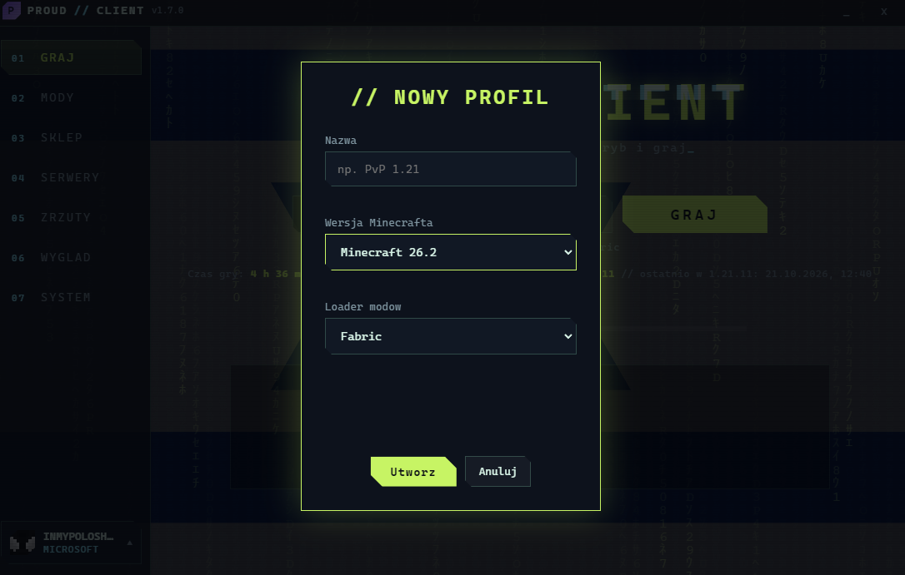
  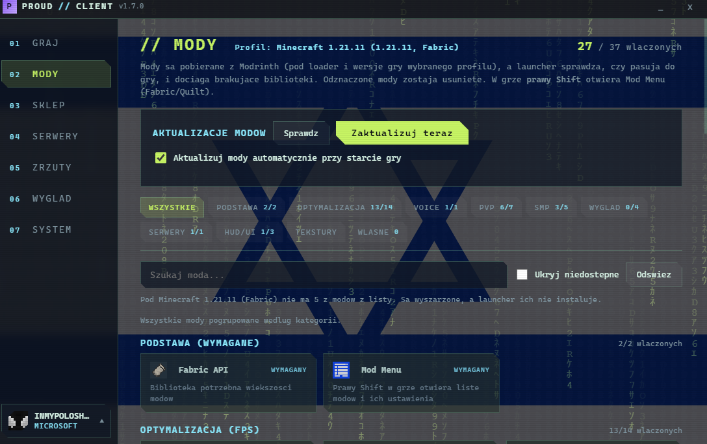

  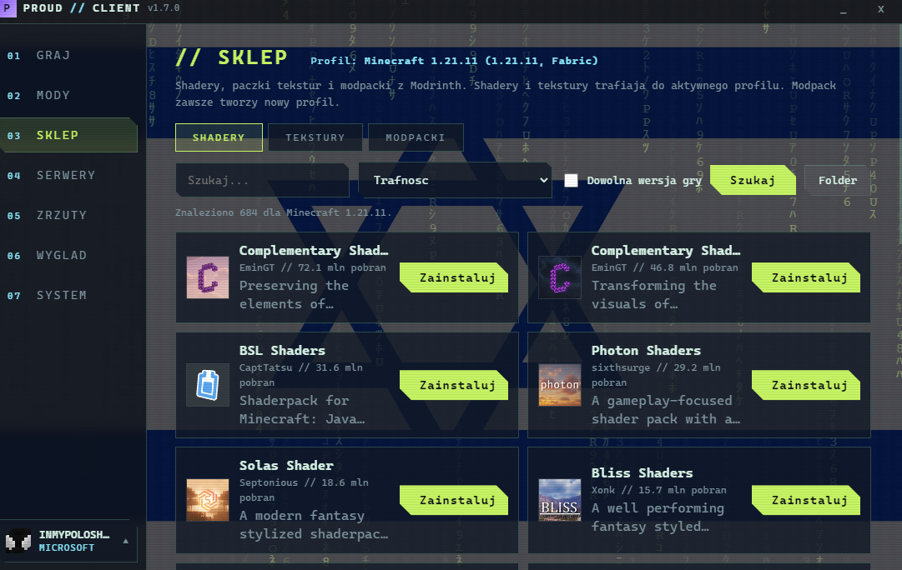
  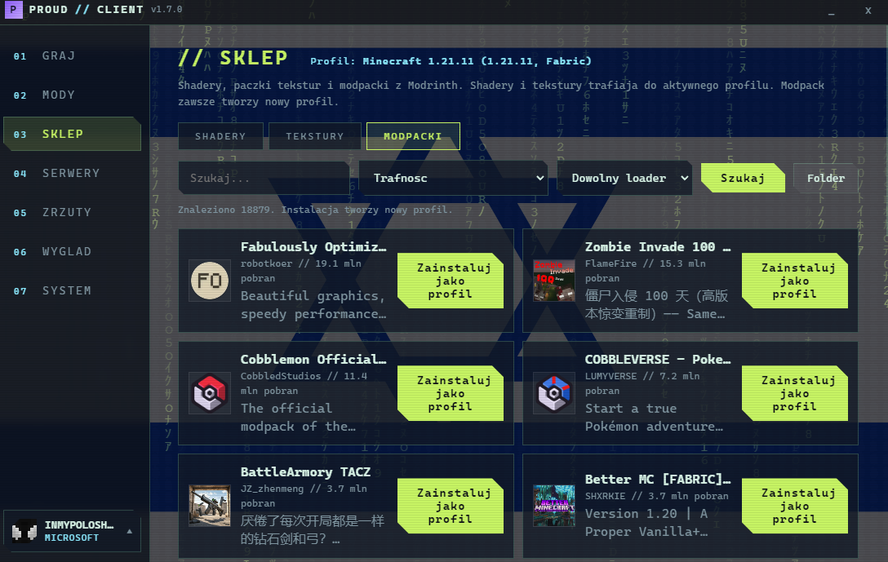

  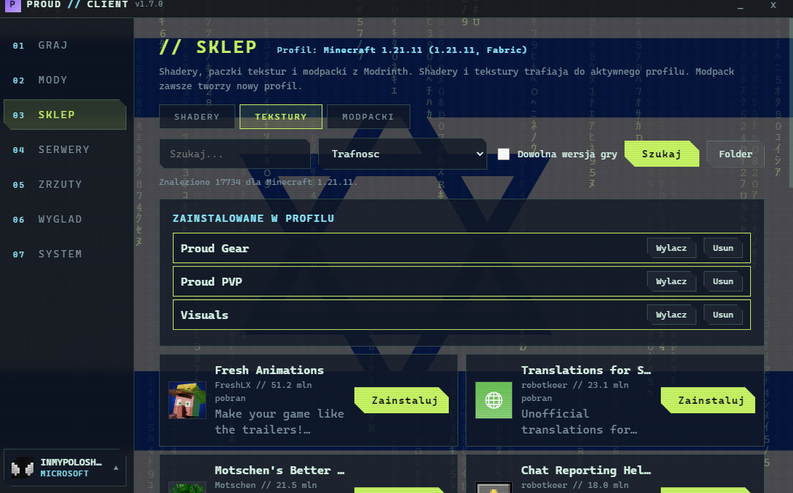
  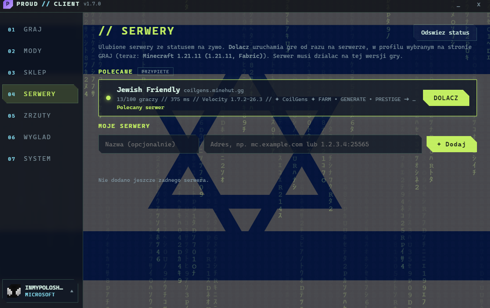

  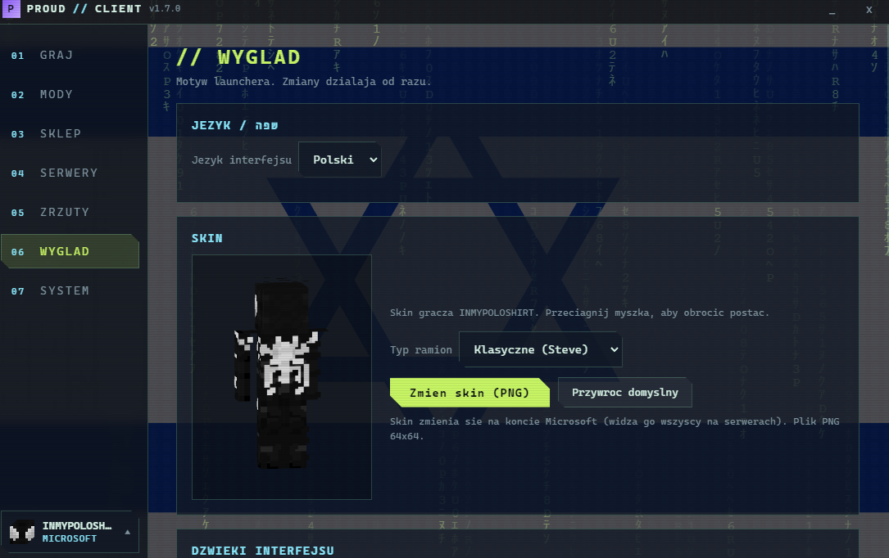
  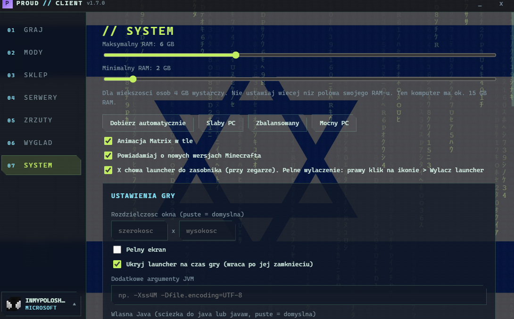

  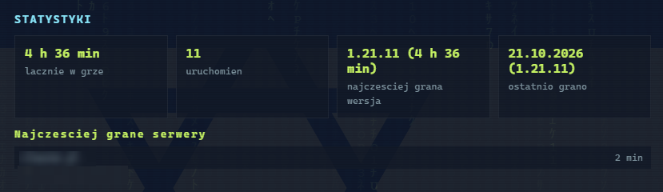
  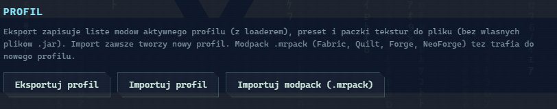

## Instalacja

1. Wejdź w [**Releases**](https://github.com/exifez/PROUD-CLIENT/releases/latest) i pobierz `Proud-Client-Setup-<wersja>.exe`.
2. Uruchom instalator.
3. Zaloguj się kontem Microsoft (albo dodaj konto offline) i kliknij **GRAJ**.

Java jest pobierana automatycznie, nie musisz niczego instalować ręcznie.

> **Windows SmartScreen może pokazać ostrzeżenie „Nieznany wydawca”.** Instalator nie jest jeszcze podpisany certyfikatem. Kliknij **Więcej informacji**, a potem **Uruchom mimo to**.

## Loadery modów

| Loader | Do czego | Uwagi |
|---|---|---|
| **Fabric** | Domyślny, pełny katalog modów launchera | Najlepiej przetestowany |
| **Quilt** | Mody Fabric plus mody Quilt | Używa Quilted Fabric API |
| **Forge** | Modpacki i mody z Modrinth | Instalator uruchamia się przy pierwszym starcie profilu |
| **NeoForge** | Nowsze modpacki (Minecraft od 1.20.2) | Jak Forge |

Katalog gotowych modów w zakładce MODY jest przygotowany pod Fabric i Quilt. Na Forge i NeoForge niedostępne pozycje są wyszarzone, resztę dodajesz ze **SKLEPU** (modpacki) albo jako własne mody.

## Najczęstsze pytania

<b>Czy to bezpieczne?</b>

Launcher pobiera mody, shadery i tekstury wyłącznie z Modrinth i sprawdza ich sumy kontrolne. Konto Microsoft logujesz przez standardowe okno Microsoftu, a hasła nie widzi ani launcher, ani autor.

<b>Czy mogę dodać własne mody?</b>

Tak, w zakładce MODY > WŁASNE, osobno dla każdego profilu.

<b>Jak działają aktualizacje?</b>

Launcher sam sprawdza nowe wersje i pyta o restart (SYSTEM > Aktualizacje). Aktualizacje modów są w zakładce MODY.

<b>Gdzie są moje światy i ustawienia?</b>

W folderze `.proudclient` w `%APPDATA%`. Odinstalowanie launchera ich nie usuwa. Każdy profil ma własny folder, a kopie światów leżą w `backups`.

<b>Czy mogę zmienić skin, mając konto offline?</b>

Nie. Skin jest przypisany do konta Microsoft na serwerach Mojang, więc zmiana działa tylko po zalogowaniu kontem Microsoft.

<b>Forge albo NeoForge nie startuje.</b>

To najnowsza część launchera. Wyślij log z SYSTEM > Diagnostyka w [zgłoszeniu](https://github.com/exifez/PROUD-CLIENT/issues/new/choose) z wersją gry i loadera, a poprawię to w kolejnej aktualizacji.

<b>Czy launcher jest open source?</b>

Nie, kod launchera nie jest tu publikowany. To repozytorium zawiera wydania, dokumentację i dane serwerów polecanych.

## Pomoc i zgłoszenia

Coś nie działa albo masz pomysł? [Otwórz zgłoszenie](https://github.com/exifez/PROUD-CLIENT/issues/new/choose) i dołącz wersję launchera, wersję gry oraz najlepiej log (SYSTEM > Diagnostyka > Wyślij ostatni log).

---

Minecraft jest znakiem towarowym Mojang AB. Proud Client nie jest powiązany z Mojang ani Microsoft. Licencja MIT dotyczy zawartości tego repozytorium (dokumentacja i dane).

